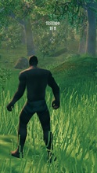
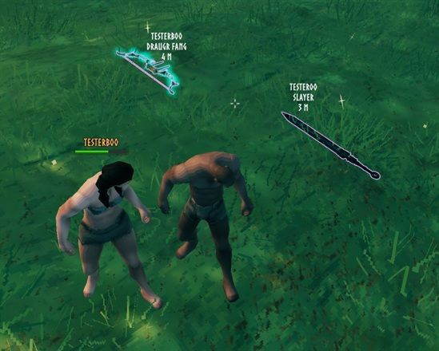
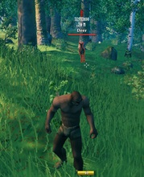
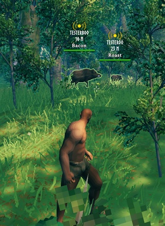
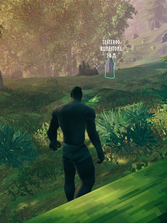
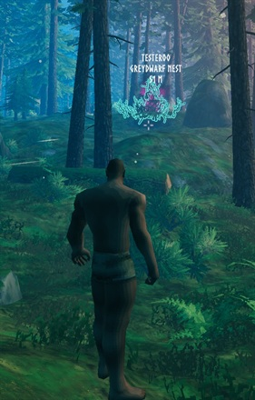
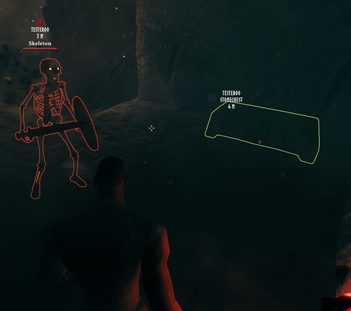
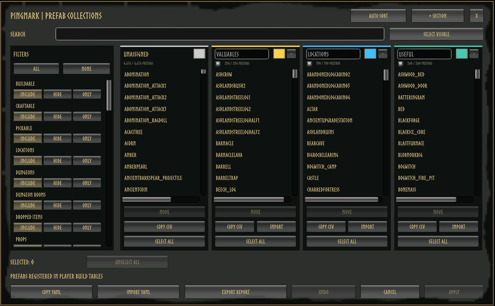

# PingMark

## Share discoveries and keep your party on target!

See **how far away** every ping is, something vanilla Valheim never shows. Aim, press **Z**, and your friends see exactly what you found: a named marker, a colored outline and a live distance.

---

### 📸 Screenshots

**See what matters at a glance.** Live distances, item names and creature highlights.

	
	
	
	

	
	
	

**Choose what your party can mark.** Objects and locations are sorted into searchable, color-coded collections.

	

---

### 🧭 Features

- **📏 Distance on every ping:** world and map pings show who pinged and how far away it is, updating as you move. Works on regular map pings too.
- **Aim and ping:** mark what you are looking at with its name and an outline.
- **Find the loot:** dropped weapons, armor and materials glow so they're easy to spot in the grass.
- **Track creatures:** highlight a mob with a nameplate and distance that follow it, colored red (hostile) or blue (friendly).
- **Mark teammates:** optionally highlight players instead of the spot they stood on (off by default).
- **Your rules:** pick which objects count as **Valuables**, **Locations** or **Useful**, and customize colors, labels, shortcuts and range.

---

### 🎮 Controls

| Shortcut | Action |
| --- | --- |
| **Z** | Highlight the creature you aim at, or ping the spot/object. |
| **Right Ctrl + P** | Turn PingMark on or off. |
| **Right Ctrl + Right Shift + P** | Open the Prefab Collections menu (admins only on servers). |

Shortcuts can be changed in the config under **9 - Inputs**.

---

### 🛠️ Prefab Collections Menu

Decide which objects get a name and outline when pinged.

- **Search and filter** every object and location in the game, including modded ones.
- **Move** objects between colored sections, or add, rename and remove sections.
- **Auto Sort** rebuilds the default Valuables, Locations and Useful sections. **Undo** reverts changes, **Apply** saves them.

> 🔒 On a server with PingMark, only admins can change collections, and the server checks every change. Collections are saved in `BepInEx/config/JoksterCube.PingMark.Collections.yml` and synced to all players.

---

## ⚙️ Installation

Install with a mod manager (r2modman, Thunderstore App), or manually:

1. Install **BepInExPack Valheim**.
2. Extract PingMark into `BepInEx/plugins`.
3. Launch the game. Settings are in `BepInEx/config/JoksterCube.PingMark.cfg`.

Installing on the server is **optional**. It syncs settings, filters ping range on the server and protects the collections.

---

### 🧩 Compatibility

- ✅ Works in single-player and on servers **without** PingMark.
- ✅ Players **without** the mod can join. They see ordinary pings (no names, outlines or highlights).
- 📏 Z pings reach players within **200 m of you** by default. Map pings stay global.
- ⚠️ On a PingMark server, modded players need a **compatible version**. Updates only require everyone to update when the network format changes (noted in the changelog).

---

### 🔧 Configuration

Most players never need to change anything. These are the settings worth knowing about. **Synced** settings come from the server when it runs PingMark.

| Setting | Default | Synced | What it does |
| --- | --- | :---: | --- |
| Z Ping Broadcast Distance | 200 m | ✔ | How far your Z pings reach. `0` = unlimited. |
| Send Z Pings To Unmodded Players | On | ✔ | Players without the mod still get an ordinary ping. |
| Ping Cooldown | 0 s | ✔ | Minimum time between Z pings. |
| Enable Other Players | Off | ✔ | Let Z highlight players. |
| Show Pinger Name / Show Distance | On | | What ping labels display. |
| Outline Width | 2 px | | `0` hides all outlines. |
| Lock Configuration | On | ✔ | Only admins can change synced settings. |

<b>Full settings reference</b>

#### 1 - General

| Setting | Default | Synced | What it does |
| --- | --- | :---: | --- |
| Enabled | On | | Turn all PingMark features on or off. |
| Lock Configuration | On | ✔ | Only admins can change synced settings. |
| Refresh Interval | 0.25 s | ✔ | How often distances update (0.05–5 s). |
| Ping Cooldown | 0 s | ✔ | Minimum time between Z pings and highlights (0–60 s). |
| Z Ping Broadcast Distance | 200 m | ✔ | Sender-to-recipient range (0–10,000 m, `0` = unlimited). Without a modded server, the shorter of both players' ranges applies. |
| Send Z Pings To Unmodded Players | On | ✔ | Send ordinary pings to players without PingMark, at any distance. |
| Debug Ping Names | Off | | Show the detected object/location IDs when pinging. Useful for editing collections. |

#### 2 - Ping Label

| Setting | Default | Synced | What it does |
| --- | --- | :---: | --- |
| Show Pinger Name | On | | Show who pinged. |
| Show Distance | On | | Show your distance to pings and highlights. |
| Show Target Name | On | | Show the pinged object's name. |
| Use Kilometers | On | | Show 1,000 m and above as km. |
| Empty Label Text | PING | | Text shown when everything above is hidden. |
| Ping Color | White | | Label color. |
| Match Ping Text To Outline | Off | | Use the outline color for the label instead. |

#### 3 - Camera Ping

| Setting | Default | Synced | What it does |
| --- | --- | :---: | --- |
| Max Distance | 500 m | | How far you can aim (10–2,000 m). |
| Max Underwater Depth | 10 m | | Deeper targets ping the water surface instead (0–100 m). |

#### 4 - Ping Targets

| Setting | Default | Synced | What it does |
| --- | --- | :---: | --- |
| Enable Drops | On | ✔ | Name and outline dropped items. |
| Enable Gravestones | On | ✔ | Name and outline gravestones. |
| Enable Other Players | Off | ✔ | Highlight players instead of pinging their position. |
| Enable All Other | Off | ✔ | Name and outline anything not in a collection. |

#### 5 - Outlines

| Setting | Default | Synced | What it does |
| --- | --- | :---: | --- |
| Enable Ping Outline | On | | Outline pinged objects and players. |
| Outline Width | 2 px | | 0–10 px, visible through walls. `0` hides outlines. |
| Ping Drop Color | Purple | | Dropped items. |
| Ping Gravestone/Player Color | Orange | | Gravestones and players. |
| Ping Anything Color | White | | Other objects. |
| Hostile / Ally Outline Color | Red / Blue | | Highlighted creatures. |

#### 6 - Mob Highlight

| Setting | Default | Synced | What it does |
| --- | --- | :---: | --- |
| Enable Mob Highlight | On | ✔ | Allow creature highlights. |
| Enable Mob Outline | On | | Outline highlighted creatures. |
| Mob Highlight Duration | 10 s | ✔ | How long a highlight lasts (1–120 s). |
| Max Highlighted Mobs | 1 | ✔ | Highlights per player at once (1–20). A new one replaces your oldest. |

#### 7 - Prefab Collections

| Setting | Default | Synced | What it does |
| --- | --- | :---: | --- |
| Color 1 – Color 12 | Gray, White, Red, Orange, Gold, Lime, Green, Teal, Cyan, Blue, Violet, Pink | | Palette that collection sections pick from. |
| Unassigned Section Color ID | 1 | | Palette slot for the menu's Unassigned column. |

#### 8 - Player Highlight

| Setting | Default | Synced | What it does |
| --- | --- | :---: | --- |
| Player Highlight Duration | 5 s | ✔ | How long a player highlight lasts (1–120 s). |
| Hide Own Player Outline | On | ✔ | Don't outline yourself when someone marks you. |

#### 9 - Inputs

| Setting | Default | Synced | What it does |
| --- | --- | :---: | --- |
| Mob Highlight Shortcut | Z | | Highlight or ping what you aim at. |
| Toggle Mod Shortcut | Right Ctrl + P | | Turn PingMark on or off. |
| Prefab Editor Shortcut | Right Ctrl + Right Shift + P | | Open the Prefab Collections menu. |
| Enable Prefab Editor Shortcut | On | | Turn the menu shortcut on or off. |

---

### 💬 Feedback & Support

Report bugs or suggest improvements on [GitHub](https://github.com/JoksterCube/PingMark/issues).

---

**Author:** JoksterCube 
**Version:** 1.2.0 
**License:** MIT
