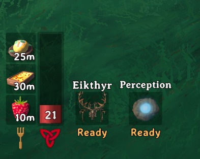

# PingMark

## Share discoveries and keep your party on target!

See **how far away** every ping is, something vanilla Valheim never shows. Aim, press **Z**, and your friends see exactly what you found: a named marker, a colored outline and a live distance. Stand still and press **Left Shift + Z** to sense loot and creatures hidden in the dark around you.

---

### 📸 Screenshots

**See what matters at a glance.** Live distances, item names and creature highlights.

	
	
	
	

	
	
	

**Sense what's hidden.** Perception has its own slot next to your Guardian Power, showing when it's ready again.

	

**Choose what your party can mark.** Objects and locations are sorted into searchable, color-coded collections.

	

---

### 🧭 Features

- **📏 Distance on every ping:** world and map pings show who pinged and how far away it is, updating as you move. Works on regular map pings too.
- **Aim and ping:** mark what you are looking at with its name and an outline, even while running.
- **Find the loot:** dropped weapons, armor and materials glow so they're easy to spot in the grass, and so do cut logs and broken ore deposits.
- **Track creatures:** highlight a mob with a nameplate and distance that follow it, colored red (hostile) or green (friendly).
- **🔮 Perception:** stand still and press **Left Shift + Z** to outline loot around you for 15 seconds, handy for coins and gems in dark dungeons. It senses whatever a ping could mark (listed objects, drops, and gravestones or players if enabled under **Ping Targets**), and nearby PingMark players see it too.
- **Sense creatures:** Perception also highlights every hostile and friendly creature around you, beyond the usual highlight limit (turn off **Perceive Creatures** to sense only objects).
- **Like a Guardian Power:** a Perception slot next to your power shows **Ready** or the time left; it's ready again 60 s after each use. Prefer a cost that grows with what you sensed? Switch **Perception Fatigue Mode** to `Relative`.
- **Mark teammates:** optionally highlight players instead of the spot they stood on (off by default).
- **Your rules:** pick which objects count as **Valuables**, **Locations** or **Useful**, and customize colors, labels, shortcuts and range.

---

### 🎮 Controls

| Shortcut | Action |
| --- | --- |
| **Z** | Highlight the creature you aim at, or ping the spot/object. |
| **Left Shift + Z** | Perception (standing still): sense objects, drops and creatures near you (nearby PingMark players see them too). |
| **Right Ctrl + P** | Turn PingMark on or off. |
| **Right Ctrl + Right Shift + P** | Open the Prefab Collections menu (admins only on servers). |

🎛️ **Ping** and **Perception** can be rebound right in the game's **Settings > Controls**. The new key keeps the shortcut's modifier, so Perception stays on Left Shift. Every shortcut can also be changed in the config under **9 - Inputs**.

---

### 🛠️ Prefab Collections Menu

Decide which objects get a name and outline when pinged.

- **Search and filter** every object and location in the game, including modded ones.
- **Move** objects between colored sections, or add, rename and remove sections.
- **Find an object's ID:** turn on **Debug Ping Names** (1 - General, shown with Advanced settings in Configuration Manager) and press **Z** on it; its IDs appear in the top-left corner.
- **Auto Sort** rebuilds the default Valuables, Locations and Useful sections, sorting modded objects too: traders and trader outposts, cut logs and deposits are listed, while rocks, roots and props that only drop wood or stone are left out. **Undo** reverts changes, **Apply** saves them. **Copy YAML** copies every section, including unapplied changes; **Import YAML** replaces all sections from the clipboard. A section's **Import** button replaces just that section from a copied CSV list or YAML section. **Export Report** writes every prefab's detected kinds and auto sort result to `BepInEx/config/JoksterCube.PingMark.AutoSortReport.csv`, useful for checking modded prefabs.

> 🔒 On a server with PingMark, only admins can change collections, and the server checks every change. Collections are saved in `BepInEx/config/JoksterCube.PingMark.Collections.yml` and synced to all players.

---

## ⚙️ Installation

Install with a mod manager (r2modman, Thunderstore App), or manually:

1. Install **BepInExPack Valheim**.
2. Extract PingMark into `BepInEx/plugins`.
3. Launch the game. Settings are in `BepInEx/config/JoksterCube.PingMark.cfg`.

Installing on the server is **optional**. It syncs settings, filters ping range on the server and protects the collections.

---

### 🧩 Compatibility

- ✅ Works in single-player and on servers **without** PingMark.
- ✅ Players **without** the mod can join. They see ordinary pings (no names, outlines or highlights).
- 📏 Z pings reach players within **200 m of you** by default. Map pings stay global.
- ⚠️ On a PingMark server, every player with PingMark needs the **same version** as the server. Players without the mod can still join.

---

### 🔧 Configuration

Most players never need to change anything. These are the settings worth knowing about. **Synced** settings come from the server when it runs PingMark.

| Setting | Default | Synced | What it does |
| --- | --- | :---: | --- |
| Z Ping Broadcast Distance | 200 m | ✔ | How far your Z pings reach. `0` = unlimited. |
| Send Z Pings To Unmodded Players | On | ✔ | Players without the mod still get an ordinary ping. |
| Ping Cooldown | 0 s | ✔ | Minimum time between Z pings. |
| Enable Other Players | Off | ✔ | Let Z highlight players. |
| Show Pinger Name / Show Distance | On | | What ping labels display. |
| Outline Width | 2 px | | `0` hides all outlines. |
| Lock Configuration | On | ✔ | Only admins can change synced settings. |

> 💡 Some settings are hidden as **Advanced** in [Configuration Manager](https://thunderstore.io/c/valheim/p/Azumatt/Official_BepInEx_ConfigurationManager/). Turn on *Advanced settings* there to see them. They are marked with ⚙️ in the full reference below.

<b>Full settings reference</b>

#### 1 - General

| Setting | Default | Synced | What it does |
| --- | --- | :---: | --- |
| Enabled | On | | Turn all PingMark features on or off. |
| Lock Configuration | On | ✔ | Only admins can change synced settings. |
| Refresh Interval ⚙️ | 0.25 s | ✔ | How often distances update (0.05–5 s). |
| Ping Cooldown | 0 s | ✔ | Minimum time between Z pings and highlights (0–60 s). |
| Z Ping Broadcast Distance | 200 m | ✔ | Sender-to-recipient range (0–10,000 m, `0` = unlimited). Without a modded server, the shorter of both players' ranges applies. |
| Send Z Pings To Unmodded Players | On | ✔ | Send ordinary pings to players without PingMark, at any distance. |
| Debug Ping Names ⚙️ | Off | | Show the detected object/location IDs when pinging. Useful for editing collections. |

#### 2 - Ping Label

| Setting | Default | Synced | What it does |
| --- | --- | :---: | --- |
| Show Pinger Name | On | | Show who pinged. |
| Show Distance | On | | Show your distance to pings and highlights. |
| Show Target Name | On | | Show the pinged object's name. |
| Use Kilometers | On | | Show 1,000 m and above as km. |
| Empty Label Text ⚙️ | PING | | Text shown when everything above is hidden. |
| Ping Color | White | | Label color. |
| Match Ping Text To Outline | Off | | Use the outline color for the label instead. |

#### 3 - Camera Ping

| Setting | Default | Synced | What it does |
| --- | --- | :---: | --- |
| Max Distance | 500 m | | How far you can aim (10–2,000 m). |
| Max Underwater Depth ⚙️ | 10 m | | Deeper targets ping the water surface instead (0–100 m). |

#### 4 - Ping Targets

| Setting | Default | Synced | What it does |
| --- | --- | :---: | --- |
| Enable Drops | On | ✔ | Name and outline dropped items. |
| Enable Gravestones | On | ✔ | Name and outline gravestones. |
| Enable Other Players | Off | ✔ | Highlight players instead of pinging their position (Perception highlights them too). |
| Enable All Other | Off | ✔ | Name and outline anything not in a collection (Perception outlines it too). |

#### 5 - Outlines

| Setting | Default | Synced | What it does |
| --- | --- | :---: | --- |
| Enable Ping Outline | On | | Outline pinged objects and players. |
| Outline Width | 2 px | | 0–10 px, visible through walls. `0` hides outlines. |
| Ping Drop Color | Purple | | Dropped items. |
| Ping Gravestone/Player Color | Orange | | Gravestones and players. |
| Ping Anything Color | White | | Other objects. |
| Hostile / Ally Outline Color | Red / Green | | Highlighted creatures. |

#### 6 - Mob Highlight

| Setting | Default | Synced | What it does |
| --- | --- | :---: | --- |
| Enable Mob Highlight | On | ✔ | Allow creature highlights. |
| Enable Mob Outline | On | | Outline highlighted creatures. |
| Mob Highlight Duration | 10 s | ✔ | How long a highlight lasts (1–120 s). |
| Max Highlighted Mobs | 1 | ✔ | Highlights per player at once (1–20). A new one replaces your oldest. |

#### 7 - Prefab Collections

| Setting | Default | Synced | What it does |
| --- | --- | :---: | --- |
| Color 1 – Color 12 ⚙️ | Gray, White, Red, Orange, Gold, Lime, Green, Teal, Cyan, Blue, Violet, Pink | | Palette that collection sections pick from. |
| Unassigned Section Color ID ⚙️ | 1 | | Palette slot for the menu's Unassigned column. |

#### 8 - Player Highlight

| Setting | Default | Synced | What it does |
| --- | --- | :---: | --- |
| Player Highlight Duration | 5 s | ✔ | How long a player highlight lasts (1–120 s). |
| Hide Own Player Outline | On | ✔ | Don't outline yourself when someone marks you. |

#### 9 - Inputs

| Setting | Default | Synced | What it does |
| --- | --- | :---: | --- |
| Ping Shortcut | Z | | Ping what you aim at, or highlight the creature you aim at. Also in Settings > Controls. |
| Toggle Mod Shortcut | Right Ctrl + P | | Turn PingMark on or off. |
| Prefab Editor Shortcut | Right Ctrl + Right Shift + P | | Open the Prefab Collections menu. |
| Perception Shortcut | Left Shift + Z | | Use Perception. Only while standing still (no other key held). Its main key can also be set in Settings > Controls. |
| Enable Prefab Editor Shortcut ⚙️ | On | | Turn the menu shortcut on or off. |

#### 10 - Perception

| Setting | Default | Synced | What it does |
| --- | --- | :---: | --- |
| Enable Perception | On | ✔ | Allow Perception and show its slot next to the Guardian Power. It senses what Ping Targets allows. |
| Perception Range | 10 m | ✔ | How far around you Perception looks. |
| Perception Duration | 15 s | ✔ | How long Perception keeps things outlined (the Perception status). |
| End Perception Early | On | ✔ | End Perception and start fatigue once every drop, pickable, chest, deposit and enemy it found is gone. |
| Perception Max Outlines | 64 | ✔ | Most objects outlined per use, nearest first. |
| Perception Fatigue Duration | 60 s | ✔ | Fixed mode: cooldown from each use, like a Guardian Power. Relative mode: the base fatigue once Perception ends. `0` = none. |
| Perception Fatigue Mode | Fixed | ✔ | `Fixed`: ready again the duration above after each use. `Relative`: fatigue starts once Perception ends, adds a cost for everything sensed, and starts early once it's all looted or slain. |
| Fatigue Per Object | 1.5 s | ✔ | Relative mode: added for each listed object outlined. |
| Fatigue Per Drop | 0.25 s | ✔ | Relative mode: added for each dropped item on the ground outlined. |
| Fatigue Per Ally | 0.5 s | ✔ | Relative mode: added for each tamed or non-hostile creature. |
| Fatigue Per Enemy | 2.5 s | ✔ | Relative mode: added for each hostile creature. |
| Perception Max Fatigue | 90 s | ✔ | Relative mode: the longest the fatigue can get. |
| Perceive Creatures | On | ✔ | Perception also highlights every hostile and allied creature in range, ignoring Max Highlighted Mobs. Players follow Enable Other Players. |
| Perception Effect | On | | Play a Guardian Power style burst around a player who uses Perception (nearby PingMark players see it too). |
| Perception Effect Color | Light blue | | Color of that burst, for your Perception and other players'. |
| Perception Sound | sfx_WishbonePing_near | | Sound played with the burst (any sound prefab, e.g. `sfx_secretfound`). Empty = silent. |

---

### 💬 Feedback & Support

Report bugs or suggest improvements on [GitHub](https://github.com/JoksterCube/PingMark/issues).

---

**Author:** JoksterCube 
**Version:** 1.5.0 
**License:** MIT
